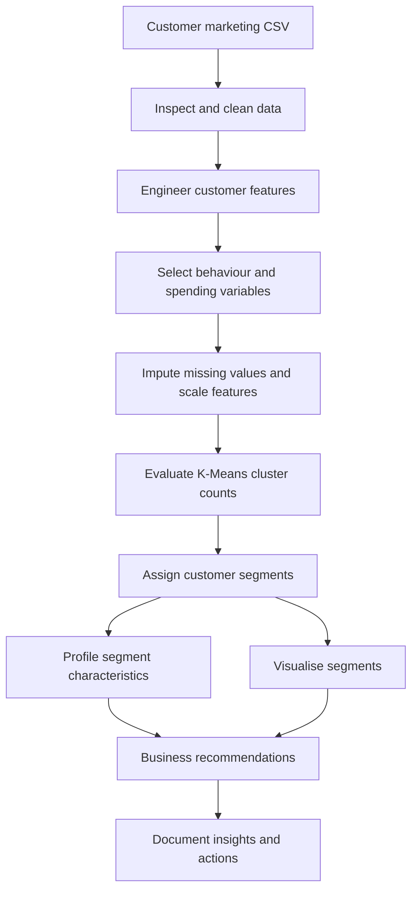

# Customer Segmentation & Business Strategy

A customer segmentation project using marketing campaign data to prepare customer features, scale selected behaviour and spending variables, apply K-Means clustering, and profile groups by demographics, purchases, channels and campaign responses. The goal is to translate observed segments into practical marketing-targeting and retention opportunities.

## Architecture Overview



## Business question

How can a business group customers by their purchasing behaviour and use those groups to improve marketing targeting, customer engagement, and retention?

## Project structure

- `src/clean_data.py` — data checks, cleaning, and feature engineering.
- `src/segment_customers.py` — feature scaling, K-Means selection, and customer segment assignment.
- `src/analyze_segments.py` — customer segment profiles and campaign/channel summaries.
- `src/create_visualizations.py` — segment size, spending, and two-dimensional cluster plots.
- `src/run_pipeline.py` — runs the workflow end to end.
- `Docs/` — project overview, data dictionary, methodology, and findings notes.
- `data/README.md` — explains how to add the local dataset.
- `requirements.txt` — required Python libraries.

## Dataset

The project is designed for the Kaggle Customer Personality Analysis dataset. It describes customer demographics, household composition, purchasing behaviour across product categories and channels, and marketing-campaign responses. Get the source from the [Kaggle dataset page](https://www.kaggle.com/datasets/imakash3011/customer-personality-analysis).

The dataset file is not included in this repository. Do not upload raw customer-level data to a public repository unless you have confirmed that you are authorised to redistribute it.

## Run the project

From the project folder, install dependencies:

```bash
pip install -r requirements.txt
```

Place the CSV at `data/raw/marketing_campaign.csv`, then run:

```bash
python src/run_pipeline.py
```

Outputs are written to `outputs/`, which is excluded from version control.

## Methods

A customer segmentation project using marketing campaign data to prepare customer features, scale selected behaviour and spending variables, apply K-Means clustering, and profile groups by demographics, purchases, channels and campaign responses. The goal is to translate observed segments into practical marketing-targeting and retention opportunities.

## Using the segments

Give each cluster a business-friendly name after reviewing its profile. Connect proposed actions to the observed spending, recency, purchase-channel, and campaign-response patterns.
